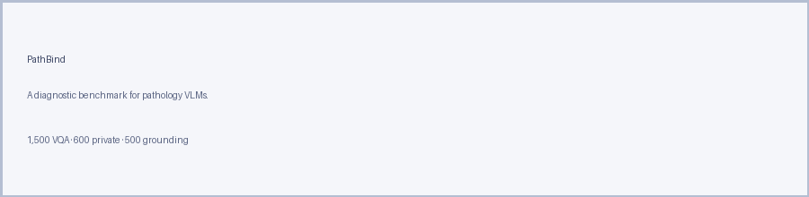

<h1 align="center">PathBind</h1>

<p align="center">
    <em>A diagnostic benchmark for evaluating pathology vision-language models.</em>
</p>

<p align="center">
    <a href="https://huggingface.co/datasets/Mikezcy/PathBind">
        
    </a>
    <a href="LICENSE">
        
    </a>
    <a href="https://www.python.org/downloads/release/python-3100/">
        
    </a>
</p>

<p align="center">
    
</p>

---

## 🌟 About PathBind

**PathBind** is a diagnostic benchmark of **2,600 samples** built to test
whether pathology vision-language models actually reason over the
microscopic image, rather than exploiting textual shortcuts.

Each of the three components is filtered by an automated pipeline followed
by expert pathologist review:

| Component              | # samples | What it probes                             |
|------------------------|----------:|--------------------------------------------|
| **PathBind-VQA**       |     1,500 | Visual dependence on public pathology VQA  |
| **PathBind-PTA**       |       600 | Cross-domain replication on a private atlas |
| **PathBind-Grounding** |       500 | Entity-level visual–semantic binding        |

Samples span six diagnostic dimensions (D1–D6) reflecting progressively
finer levels of pathology visual reasoning:

| Dim. | Name                            |
|:----:|---------------------------------|
| D1   | Coarse tissue/organ recognition |
| D2   | Cellular morphology             |
| D3   | Cell–stroma interaction         |
| D4   | Spatial localization            |
| D5   | Diagnostic reasoning            |
| D6   | Staining and IHC interpretation |

---

## 🚀 Load PathBind

PathBind is hosted as a **gated dataset** on the Hugging Face Hub. Request
access, then download:

```bash
pip install huggingface_hub
huggingface-cli login    # or set HF_TOKEN env var
huggingface-cli download Mikezcy/PathBind --repo-type dataset \
    --local-dir ./PathBind_data
```

The resulting directory looks like:

```
PathBind_data/
├── PathBind-VQA/
│   └── manifest.tsv               # sample IDs only
├── PathBind-PTA/
│   └── pathbind_pta_600.tsv       # self-contained, base64 JPEGs inline
└── PathBind-Grounding/
    └── manifest.jsonl             # sample IDs only
```

### PathBind-VQA and PathBind-Grounding: materialize the full data

We ship sample IDs only, so you must obtain the source datasets (PathMMU,
Path-VQA, Quilt-VQA, MedXpert-Path, OmniMed-Bright for VQA; PathVG for
Grounding) yourself and materialize the full files:

```bash
# VQA: builds pathbind_vqa_1500.tsv from your local source copies
python pathbind/data/PathBind-VQA/build.py \
    --pathmmu_dir  /path/to/PathMMU  \
    --pathvqa_dir  /path/to/Path-VQA \
    --quiltvqa_dir /path/to/Quilt-VQA \
    --omnimed_dir  /path/to/OmniMed-Bright \
    --medxpert_dir /path/to/MedXpert-Path

# Grounding: builds pathbind_grounding_500.jsonl from your local PathVG
python pathbind/data/PathBind-Grounding/build.py --pathvg_dir /path/to/PathVG
```

### PathBind-PTA

Nothing to do — the shipped TSV embeds all 600 images as base64.

---

## 🔬 Running an evaluation

### VQA evaluation

Compute per-sample accuracy with and without the image, plus the
Multimodal Gain:

```bash
python -m pathbind.eval_vqa \
    --data PathBind-VQA/pathbind_vqa_1500.tsv \
    --model_module pathbind.models.patho_r1 --ckpt /path/to/Patho-R1 \
    --out results/patho-r1_vqa.jsonl
```

Also works on PathBind-PTA by pointing `--data` at the PTA TSV.

### Grounding evaluation

Compute region-level attention overlap against the ground-truth bounding
box (IoU / Precision / Recall):

```bash
python -m pathbind.eval_grounding \
    --data PathBind-Grounding/pathbind_grounding_500.jsonl \
    --model_module pathbind.models.patho_r1 --ckpt /path/to/Patho-R1 \
    --out results/patho-r1_grounding.jsonl
```

### One-command all-in-one

```bash
CKPT=/path/to/Patho-R1 GPUS=0 bash scripts/run_patho_r1.sh
```

### Porting a new model

Copy [`pathbind/models/patho_r1.py`](pathbind/models/patho_r1.py) and
implement:

- `generate(messages, max_new)` — returns a decoded string (needed for VQA).
- `forward_with_attn(messages)` — returns `{input_ids, attentions, img_span, patch_grid}` (needed for grounding).

Then pass `--model_module pathbind.models.<yours>` to the evaluators.

---

## ✒️ Citation

Coming soon.

---

## 📄 License

Code is released under the [MIT License](LICENSE).

- `PathBind-VQA` and `PathBind-Grounding` manifests: MIT. Referenced source
  datasets remain under their **original licenses** — please follow the
  terms of PathMMU / Path-VQA / Quilt-VQA / MedXpert-Path / OmniMed-Bright /
  PathVG when using them.
- `PathBind-PTA` component: **CC BY-NC 4.0** — non-commercial research use
  only, not for clinical diagnostic use.
